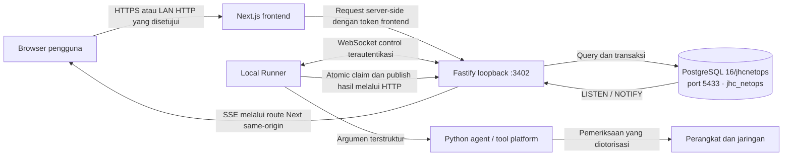
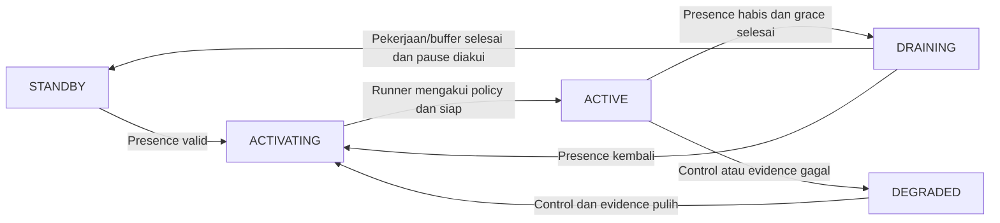

# JHC NetOps Monitor

JHC NetOps Monitor membantu tim IT memantau jaringan, menjalankan pemeriksaan
terarah, dan mengelola inventaris perangkat melalui satu workspace. Aplikasi
mencakup Health Watch, Traffic Live, Managed SNMP, Discovery, Device Inspector,
diagnostik LAN, inventaris aset, laporan Excel, dan registri alat medis.

Dokumentasi ini menjelaskan **source yang ada di repository**, termasuk P18
monitoring berbasis presence. Status instalasi atau acceptance production harus
dibuktikan dari release dan catatan operator; keberadaan fitur di source bukan
bukti bahwa fitur tersebut sudah diuji pada perangkat nyata.

## Mulai membaca dari mana?

| Kebutuhan | Dokumen |
| --- | --- |
| Memahami fungsi aplikasi dan istilahnya | Bagian fitur dan alur penggunaan di bawah |
| Menjalankan UI atau mengembangkan frontend | [Frontend](frontend/README.md) |
| Memahami API, autentikasi, dan penyimpanan | [Backend](backend/README.md) |
| Menyiapkan mesin pelaksana pemeriksaan | [Runner](runner/README.md) dan [agent](agent/README.md) |
| Memahami monitoring aktif/siaga P18 | [P18 Zero Idle](docs/P18_ZERO_IDLE.md) |
| Menyiapkan akun dan akses | [Local Auth](docs/AUTH_SETUP.md) |
| Menyiapkan atau memulihkan database | [PostgreSQL](deploy/postgresql/README.md) |
| Mencari panduan domain, desain, atau riwayat fase | [Indeks dokumentasi](docs/README.md) |

## Fitur dan batas penggunaannya

| Fitur | Kegunaan | Cara membaca hasil |
| --- | --- | --- |
| Dashboard / Health Watch | ICMP terjadwal untuk target inventaris yang dipilih, riwayat latensi/loss, dan perubahan status | Tidak merespons ICMP tidak membuktikan perangkat mati. Periksa timestamp dan status monitoring. |
| Manual Ping | Satu pemeriksaan ICMP atas target Health Watch yang sudah diotorisasi | Admin-only; antrean, runner sibuk/offline, timeout, dan unreachable memiliki arti berbeda. |
| Traffic Live | Capture terbatas pada interface runner, menghasilkan RX/TX, packet, protocol, dan flow | Header-only; bukan isi komunikasi, capture seluruh LAN, atau tes kapasitas link. |
| LAN Diagnostics | Pengukuran throughput iperf3 dan jalur MTR terhadap allowlist runner | Aktif/on-demand; MTR menunjukkan hop Layer 3 yang merespons, bukan seluruh switch Layer 2. |
| Network Discovery | Menemukan host dalam scope yang ditentukan dan divalidasi runner | Hasil temuan belum otomatis menjadi inventaris yang disetujui. |
| Device Inspector | Fingerprint terbatas satu perangkat yang sudah diotorisasi | Identitas yang terdeteksi adalah evidence beserta tingkat keyakinannya. |
| Managed SNMP | Identitas sistem, interface, counter/rate, dan kondisi target SNMP read-only | Timestamp, baseline counter, dan periode standby memengaruhi kesegaran hasil. |
| Observed LAN Hosts | Tetangga IPv4 private yang terlihat dalam evidence SNMP perangkat sumber | Bukan daftar semua host LAN atau hasil scan; NetBIOS hanya enrichment nama. |
| Asset Inventory | Menggabungkan evidence inventaris, scan, dan telemetry; menampilkan perubahan serta endpoint history | `asset.assets.id` adalah identitas canonical; IP bukan identitas permanen perangkat. |
| Scan Networks | Mengatur jaringan private yang boleh dipakai Quick/Deep Asset Scan | Scan aktif harus dimulai eksplisit; route yang tersedia tidak otomatis mengizinkan scanning. |
| Medical Equipment | Registri operasional, relasi aset jaringan opsional, kalibrasi, dan servis | Tidak menyimpan data pasien atau rekam klinis. |
| Reporting & Admin | Ekspor Excel, branding laporan, pengelolaan akun, dan audit administratif | Otorisasi dipastikan kembali oleh server; menyembunyikan tombol saja bukan kontrol akses. |

## Arsitektur yang berjalan



Next.js menangani halaman, session pengguna, Server Actions, dan proxy stream.
Fastify memvalidasi request, menyimpan job/hasil, serta mengatur realtime dan
monitoring policy. Runner mengambil pekerjaan secara atomik lalu mengorkestrasi
tool lokal. Agent mengumpulkan dan menormalisasi hasil.

PostgreSQL adalah sumber data utama. WebSocket menyampaikan pemberitahuan work
dan policy, bukan perintah bebas. SSE memberitahu UI bahwa data berubah; UI lalu
membaca ulang state dari backend. Kedua transport tersebut tidak menggantikan
antrean job yang tersimpan di database.

| Komponen | Teknologi / alamat yang relevan |
| --- | --- |
| Frontend | Next.js 16, React 19, TypeScript; dev `:3000`, launcher deployment `:3401` |
| Backend | Fastify 5, TypeScript, `pg`, `ws`; loopback `127.0.0.1:3402` |
| Database | PostgreSQL 16, cluster `16/jhcnetops`, DB `jhc_netops`, port `5433` |
| Runner | Node.js ESM; native Ubuntu atau Windows dengan agent Linux di WSL |
| Agent | Python >=3.11, psutil, Scapy, PySNMP, dan tool platform sesuai fitur |
| Hermes | [Scaffold terpisah](hermes-agent/README.md); belum menjadi layanan analisis aktif |

### Istilah yang sering muncul

| Istilah | Arti dalam NetOps |
| --- | --- |
| Runner | Mesin/proses yang benar-benar menjalankan pemeriksaan jaringan |
| Agent | Program Python yang dipanggil runner untuk mengumpulkan/menormalisasi hasil |
| Target / assignment | Perangkat yang dipilih untuk fitur tertentu, beserta runner yang bertanggung jawab |
| Job / session | Satu pekerjaan yang tercatat, dari queued sampai selesai/gagal |
| Lease | Batas waktu hak memproses job; pekerjaan yang terlalu lama dapat expired/recovered |
| Evidence / observation | Fakta yang teramati pada waktu tertentu; bukan kepastian identitas atau kondisi selamanya |
| Freshness | Seberapa baru observasi/heartbeat dibanding ambang waktu yang berlaku |
| Canonical asset | Record perangkat utama dengan ID stabil; beberapa interface/IP dapat terkait dengannya |
| SSE | Stream satu arah dari aplikasi ke browser untuk pemberitahuan perubahan atau state monitoring |
| WebSocket | Koneksi dua arah runner–backend untuk control, health, dan work hint |
| Refetch / invalidation | Pemberitahuan bahwa data berubah, lalu pembacaan ulang state yang resmi |
| CIDR | Notasi jaringan seperti `192.168.10.0/24`; bukan izin otomatis untuk memindai jaringan itu |

## Monitoring aktif, siaga, dan kesegaran data

P18 mengaitkan monitoring terjadwal dengan tab aplikasi terlindungi yang terlihat
dan mempunyai session approved. Menutup, meminimalkan, atau memindahkan tab
terakhir ke background dapat membuat monitoring masuk siaga setelah grace period
(default 30 detik). Membuka kembali tab yang terlihat memicu pemuatan assignment
dan monitoring kembali.



State di atas menyatakan kondisi monitoring, bukan kondisi setiap perangkat.
Nilai lama tetap tersimpan saat siaga. **Insiden selama standby tidak dapat
dideteksi sampai monitoring dilanjutkan.** Periksa waktu observasi terakhir;
`ACTIVE` pun tidak berarti setiap nilai diukur pada detik yang sama.

Pekerjaan manual yang sudah diterima dan hasil yang belum terpublikasi tetap
diselesaikan. Target zero-idle P18 adalah nol **HTTP periodik** pada standby
sehat dan bersih; frame WebSocket, heartbeat database, pemeriksaan antrean, serta
expiry maintenance tetap ada. Jalur HTTP lokal P17 dipertahankan untuk
kompatibilitas/recovery, bukan fallback ke layanan remote.

## Akses pengguna

Pengguna baru berstatus `pending` dan belum dapat membuka workspace terlindungi.
Role baru berlaku setelah profile approved.

| Peran | Akses umum |
| --- | --- |
| Viewer | Membaca workspace dan hasil yang diizinkan; tanpa menjalankan operasi jaringan |
| Operator | Hak baca serta operasi jaringan/configuration yang memang diberikan oleh action terkait |
| Admin | Operasi serta administrasi akun/branding; Manual Ping dan konfigurasi penuh SNMP tetap Admin-only |

`disabled` berbeda dari rejected/suspended: login ditolak dan session dicabut saat
disable. Akun existing tanpa credential lokal memerlukan enrollment operator,
bukan registrasi ulang berdasarkan email. Prosedur ada di [AUTH_SETUP](docs/AUTH_SETUP.md).

## Contoh alur penggunaan setelah sistem siap

1. **Masuk dan periksa status.** Login dengan akun approved, buka Dashboard,
   lalu pastikan runner dan monitoring banner menunjukkan kondisi yang benar.
2. **Mulai dari perangkat yang dikenal.** Gunakan Devices untuk inventory dan
   profile. Menyimpan nama/IP tidak boleh dianggap otomatis menjalankan scan.
   Discovery atau Inspector dilakukan terpisah dengan scope yang diotorisasi.
3. **Pilih monitoring yang dibutuhkan.** Assign Health Watch atau Managed SNMP
   ke runner yang sesuai, lalu pilih interval. SNMP memerlukan profile credential
   lokal resmi; nama profile saja tidak membuktikan autentikasi siap.
4. **Lakukan diagnosis sesuai pertanyaan.** Gunakan Ping untuk respons ICMP,
   Traffic untuk trafik pada interface runner, dan LAN Diagnostics untuk
   throughput/path. Jangan membandingkan ketiganya seolah mengukur hal yang sama.
5. **Tinjau dan laporkan.** Periksa timestamp/evidence pada Asset/Profile,
   perubahan identitas di Asset History, lalu ekspor laporan sesuai filter.
   Kegagalan query berbeda dari hasil kosong.

Ketika pengguna menutup atau mem-background tab terakhir, ingat policy standby
P18. Pilih proses operasional yang sesuai bila organisasi membutuhkan pengamatan
tanpa jeda; source saat ini tidak boleh disebut monitoring unattended 24/7 hanya
karena proses runner tetap online.

## Setup development

### Prasyarat

- Node.js yang mendukung script repository; launcher saat ini memakai Node
  `22.23.2`, backend mendeklarasikan minimum `22.12`. Gunakan versi yang direview
  untuk seluruh gate, tanpa mengubah default Node proyek lain.
- Python >=3.11 dan Linux/WSL untuk agent serta tool yang dibutuhkan fitur.
- Database NetOps yang sudah diprovision dan dimigrasi secara eksplisit bila
  menjalankan aplikasi penuh. `npm ci` tidak membuat database atau akun Admin.
- Token backend untuk frontend dan runner yang berbeda, serta credential DB
  khusus aplikasi. Gunakan file example sebagai struktur, bukan credential siap pakai.

### Instalasi dependensi

Dari root repository, buat file lokal hanya jika belum ada. Jangan menimpa
environment/config yang sudah dikonfigurasi.

```powershell
if (!(Test-Path backend\.env)) { Copy-Item backend\.env.example backend\.env }
if (!(Test-Path frontend\.env.local)) { Copy-Item frontend\.env.example frontend\.env.local }
if (!(Test-Path runner\.env)) { Copy-Item runner\.env.example runner\.env }
if (!(Test-Path runner\config.local.json)) { Copy-Item runner\config.example.json runner\config.local.json }

npm.cmd --prefix backend ci
npm.cmd --prefix frontend ci
npm.cmd --prefix runner ci
```

Siapkan agent dari Linux/WSL; detail tool dan privilege ada di [agent README](agent/README.md).

```bash
cd agent
python3 -m venv .venv
.venv/bin/python -m pip install -e .
```

Samakan pasangan konfigurasi berikut tanpa mencetak nilainya:

| Backend | Komponen pemakai |
| --- | --- |
| `FRONTEND_API_TOKEN` | `frontend`: `LOCAL_BACKEND_FRONTEND_TOKEN` |
| `RUNNER_API_TOKEN` | `runner`/agent: `LOCAL_BACKEND_TOKEN` |
| Loopback `HOST` + `PORT` | `LOCAL_BACKEND_URL` di komponen pemakai |
| `APPLICATION_DATABASE_URL` dan `DATABASE_URL` | Dua konfigurasi modul menuju dedicated DB yang sama |

### Menjalankan lokal

Setelah environment, database, dan akun siap, jalankan pada terminal terpisah:

```powershell
npm.cmd --prefix backend run dev
npm.cmd --prefix frontend run dev
npm.cmd --prefix runner start
```

Buka `http://localhost:3000`. Runner memuat file yang dirujuk
`environment_file` dalam config. Menghidupkan runner dapat memproses pekerjaan
yang sudah ada; jalankan hanya pada lingkungan dan target yang Anda otorisasi.
`--once` bukan dry run. Lihat [runner README](runner/README.md) untuk preflight.

Untuk pengembangan tampilan SNMP, [Portable Development](docs/PORTABLE_DEVELOPMENT.md)
menyediakan fixture read-only. Mode ini tidak menyediakan seluruh backend,
session login, atau emulator SNMP.

## Verifikasi

Perintah berikut menjalankan gate lokal; hasilnya harus dicatat saat benar-benar
dijalankan, bukan disimpulkan dari dokumentasi ini.

```powershell
npm.cmd --prefix backend test
npm.cmd --prefix backend run typecheck
npm.cmd --prefix backend run lint
npm.cmd --prefix backend run build
npm.cmd --prefix frontend test
npm.cmd --prefix frontend run typecheck
npm.cmd --prefix frontend run lint
npm.cmd --prefix frontend run build
npm.cmd --prefix runner test
git diff --check
```

Agent: jalankan `python -m pytest` dari folder `agent` pada environment pengujian
yang sudah memasang pytest. Uji PostgreSQL dan Playwright bersifat terpisah serta
memerlukan lingkungan terisolasi; petunjuk ada di README komponen. Lulus unit
test/build tidak membuktikan acceptance SNMP, capture, browser, atau production.

## Troubleshooting awal

| Gejala | Periksa lebih dahulu |
| --- | --- |
| Login gagal | Backend tersedia, token frontend cocok, profile mempunyai credential lokal, dan akun tidak disabled |
| Runner offline/degraded | Preflight platform, token runner, runner ID, heartbeat timestamp, capability, dan control socket |
| Monitoring dijeda | Presence tab visible, session approved, grace period, pekerjaan/buffer yang masih draining |
| Job lama queued | Runner yang dituju, capability, lease, koneksi control, dan log claim; jangan hapus row untuk menyembunyikan masalah |
| Traffic kosong | Interface capture, session, privilege helper/CAP_NET_RAW, serta apakah trafik benar-benar melewati interface itu |
| SNMP tidak fresh | Target enabled/assignment, referensi credential, monitoring state, hasil poll terakhir; jangan menganggap snapshot lama sebagai live |
| Chart historis kosong | Bedakan query error dari hasil kosong, target/range yang dipilih, waktu sampel, dan periode standby |
| UI reconnect/fallback | Session, SSE same-origin, backend LISTEN, dan authoritative refetch; jangan menilai kesehatan dari label koneksi saja |

## Deployment, data, dan keamanan

Deployment menggunakan release immutable, shared config/state, dan launcher yang
direview. Baca [backend](backend/README.md), [runner](runner/README.md),
[P18](docs/P18_ZERO_IDLE.md), dan [runbook PostgreSQL](deploy/postgresql/README.md)
sebelum melakukan perubahan operasional. Gunakan satu process manager untuk
setiap proses; backend P18 harus satu instance karena presence berada di memory.

- Database hanya `16/jhcnetops:5433/jhc_netops`; `16/main:5432` dan database
  proyek lain berada di luar scope.
- Startup tidak menjalankan migration, tetapi dapat melakukan recovery job dan
  inisialisasi konfigurasi. Menjalankan candidate ke DB live bukan uji read-only.
- Backup harus meliputi database, branding, dan state/config yang diperlukan
  recovery. Perlakukan backup config sebagai rahasia; jangan masukkan ke Git.
- Credential SNMP tinggal lokal pada runner; aplikasi menyimpan referensi profil.
- Jangan menyimpan raw PCAP, payload, cookie, token, password, atau data pasien
  dalam source/log/laporan. Browser tidak menerima DSN atau bearer backend.
- Rollback kode tidak mengembalikan schema/data. Gunakan release yang kompatibel
  dan prosedur rollback yang direview.

Folder [supabase](supabase/README.md) dan tooling P12/P13 menyimpan bukti historis.
Mereka bukan dependency runtime aktif atau petunjuk menghidupkan kembali authority
lama. Jangan menghapus migration/evidence untuk merapikan repository.
