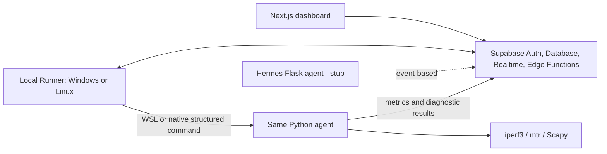

# Network Monitoring

Dashboard monitoring dan diagnostik jaringan untuk kebutuhan IT Support. Project ini
menggabungkan dashboard Next.js, Supabase, Python agent, dan Local Runner lintas
Windows/WSL atau native Linux untuk memberikan visibilitas jaringan tanpa
menyimpan raw packet atau PCAP.

## Fitur utama

- Auth Supabase dengan status akses terpisah dan role Viewer/Operator/Admin.
- Dashboard metrik jaringan dan status target Network Health Watch.
- Live Traffic berbasis metadata header/5-tuple dengan scope **This Device**.
- LAN Diagnostics on-demand menggunakan `iperf3` dan `mtr`.
- Perbandingan bandwidth berdasarkan lokasi, target, serta WiFi/Ethernet.
- Pelabelan manual responding Layer-3 hop melalui inventory `network_nodes`.
- On-demand Network Discovery yang bounded untuk Operator/Admin.
- Managed SNMP read-only untuk device/interface telemetry target yang disetujui.
- Observed LAN Hosts dari evidence neighbor Layer-3, dengan naming enrichment opsional.
- Buffer SQLite lokal untuk toleransi gangguan koneksi backend.

Hermes AI Agent masih berupa endpoint stub dan belum menjalankan analisis LLM.

## Arsitektur



Browser tidak dapat menjalankan shell command lokal. Runner hanya menerima job
terstruktur dan me-resolve target dari allow-list lokal sebelum memanggil agent.

Windows + Ubuntu WSL tetap didukung. Runtime native Linux P8A telah divalidasi
pada staging. P8B menyediakan template always-on systemd yang belum dipasang
atau diaktifkan pada Mini PC. Lihat
[Technical Handover](docs/HANDOVER.md) dan
[Native Ubuntu always-on deployment](docs/UBUNTU_ALWAYS_ON_DEPLOYMENT.md).

## Struktur repository

| Folder | Fungsi |
|---|---|
| [`agent`](agent/README.md) | Agent Python, metrik, diagnostics, dan capture traffic header-only. |
| [`frontend`](frontend/README.md) | Dashboard Next.js App Router. |
| [`runner`](runner/README.md) | Orkestrasi Windows/Linux, heartbeat, Health Watch, dan job lokal. |
| [`supabase`](supabase/README.md) | Migration, RLS, dan Edge Functions. |
| [`hermes-agent`](hermes-agent/README.md) | Service Flask untuk AI analysis; saat ini masih stub. |
| [`scripts`](scripts/README.md) | Helper setup, target allow-list, dan verifikasi. |
| [`docs`](docs/README.md) | PRD, aturan implementasi, setup, design system, dan planning. |

Folder `data`, virtual environment, build output, log, `.env`, dan konfigurasi lokal
runner diabaikan oleh Git.

## Prasyarat

- Windows dengan WSL2, atau Ubuntu 24.x native untuk jalur P8A yang masih perlu
  validasi host.
- Python 3.11 atau lebih baru di WSL/native venv.
- Node.js 22 untuk frontend dan runner.
- Project Supabase dan Supabase CLI untuk migration/deployment.
- `iperf3` dan `mtr` di runtime Linux untuk LAN Diagnostics.
- Server `iperf3 -s` pada target yang sudah mendapat izin.

## Quick start development

### 1. Siapkan environment

Salin file example pada komponen yang diperlukan, lalu isi nilainya secara lokal:

```powershell
Copy-Item frontend\.env.example frontend\.env.local
Copy-Item runner\.env.example runner\.env
```

Di WSL:

```bash
cp agent/.env.example agent/.env
cp hermes-agent/.env.example hermes-agent/.env
```

Jangan pernah menaruh `SUPABASE_SERVICE_ROLE_KEY` di frontend atau commit file
`.env`. Lihat [Auth setup](docs/AUTH_SETUP.md) dan
[Agent setup](docs/AGENT_SETUP.md) untuk konfigurasi lengkap.

### 2. Terapkan Supabase

```powershell
npx supabase login
npx supabase link --project-ref YOUR_PROJECT_REF
npx supabase db push
```

Deploy Edge Function yang diperlukan sesuai [Supabase README](supabase/README.md).

### 3. Jalankan frontend

```powershell
cd frontend
npm ci
npm run dev
```

Buka `http://localhost:3000`.

### 4. Siapkan agent Linux

```bash
cd agent
python3 -m venv .venv
source .venv/bin/activate
python -m pip install --upgrade pip
python -m pip install -e .
sudo apt install iperf3 mtr-tiny
```

Pada Windows perintah ini dijalankan di distro WSL. Untuk native Ubuntu P8A,
buat venv baru di release yang aktif; jangan salin venv dari Windows/WSL.

### 5. Siapkan runner

Untuk development, salin `runner/config.example.json` menjadi
`runner/config.local.json`. Windows memakai distro/path WSL; Linux memakai
absolute `native_project_root`. Deployment native permanen memakai file bernama
`/var/www/jhc/jhc_noc/shared/runner/config.json`, dibuat dari
`deploy/runner-config.example.json`; jangan commit config atau secret nyata.

Dari root project di PowerShell:

```powershell
.\start-diagnostics.ps1
```

Panduan penggunaan hariannya tersedia di [PANDUAN.md](docs/PANDUAN.md).

## Verifikasi

```powershell
cd frontend
npm run lint
npm run typecheck
npm test
npm run build

cd ..\runner
npm test
```

Di WSL:

```bash
cd agent
source .venv/bin/activate
python -m pip install pytest
python -m pytest
```

## Batasan penting

- Live Traffic hanya menunjukkan traffic yang terlihat pada device runner, bukan
  seluruh LAN dan bukan available bandwidth.
- WiFi diagnostics adalah pengukuran end-to-end, bukan bukti bottleneck LAN kabel.
- MTR hanya menunjukkan responding Layer-3 hops, bukan setiap switch Layer-2.
- Hasil membantu menemukan **suspected bottleneck**, bukan membuktikan perangkat
  tertentu rusak tanpa bukti tambahan.
- Network Discovery tidak melakukan port scan, service scan, OS fingerprinting,
  vulnerability scan, SNMP, atau pemindaian berkala.
- Jalankan active diagnostics hanya terhadap target yang telah diotorisasi.

## Dokumentasi sumber kebenaran

Sebelum mengubah arsitektur atau fitur, baca:

1. [PRD.md](docs/PRD.md)
2. [AGENTS.md](docs/AGENTS.md)
3. [DESIGN.md](docs/DESIGN.md)
4. [PLANNING.md](docs/PLANNING.md)
5. [HANDOVER.md](docs/HANDOVER.md)
