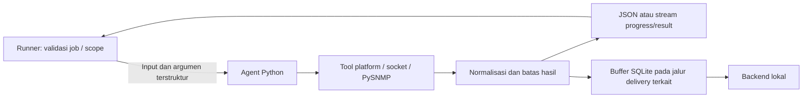

# JHC NetOps Python Agent

Agent menyediakan collector dan normalisasi hasil untuk Local Runner. Runner
mengatur authorization/scope/lifecycle job; agent menjalankan tool yang telah
dibatasi dan mengeluarkan hasil terstruktur. Database diakses melalui backend
lokal, bukan dari collector menggunakan DSN.

## Peran agent dalam sistem



Traffic Live mengagregasi header/flow; tidak menyimpan raw PCAP atau isi paket.
Managed SNMP memakai OID tetap dan profil yang di-resolve runner. Device Inspector
memeriksa satu target dengan probe terbatas. Agent tidak boleh menjadi arbitrary
shell, scanner bebas, atau tempat menebak credential.

Tidak setiap fungsi runner mempunyai subcommand Python sendiri: Health Watch,
Manual Ping, dan pengumpulan konteks Discovery juga memakai helper platform
runner. Asset Quick/Deep Scan memiliki helper backend tersendiri. Jangan membuat
proses agent tambahan untuk menduplikasi pekerjaan tersebut.

## Instalasi development

Gunakan Python >=3.11. Pada native Ubuntu atau di dalam WSL, dari folder `agent`:

```bash
python3 -m venv .venv
.venv/bin/python -m pip install -e .
.venv/bin/network-monitor --help
```

`pyproject.toml` mendefinisikan paket, dependency, dan entrypoint
`network-monitor`; `uv.lock` menyimpan lock dependency untuk workflow yang
menggunakannya. Instalasi editable di atas adalah setup development, bukan bukti
bahwa runtime sudah identik dengan release yang diuji. Venv Linux harus dibuat
pada lingkungan Linux; jangan menyalin venv Windows ke WSL/Ubuntu.

Jangan menjalankan `network-monitor` tanpa subcommand sekadar mengecek instalasi:
jalur default masuk ke loop aggregate metrics. Gunakan `--help` atau
`capabilities` untuk melihat kontrak terlebih dahulu.

## Entrypoint yang tersedia

| Subcommand | Fungsi / catatan |
| --- | --- |
| `capabilities` | Informasi capability lokal yang dinormalisasi |
| `monitor` | Loop metrics independen; bukan proses yang wajib ditambahkan pada deployment runner normal |
| `bandwidth-test` | Satu pengukuran iperf3 terarah; traffic aktif ke server tujuan |
| `path-test` | Satu pengukuran MTR terarah |
| `diagnostic-run` | Suite diagnostik terstruktur yang digunakan runner |
| `traffic-live` | Capture header-only bounded dengan progress/snapshot dan stop handling |
| `traffic-interface-check` | Resolusi/pemeriksaan interface lokal; helper internal |
| `device-inspect` | Fingerprint bounded satu target sesuai session |
| `managed-telemetry-poll` | Satu collection Managed SNMP sesuai payload runner |

Daftar flag lengkap ada pada `--help` per subcommand dan
[main.py](network_monitoring_agent/main.py). Adanya flag CLI tidak mengizinkan
browser mengendalikan target, timeout, OID, capture filter, atau concurrency
arbitrer. Production memanggilnya melalui kontrak runner yang direview.
Tidak ada contoh probe otomatis di README ini.

## Tool dan privilege

| Fitur | Kebutuhan yang perlu diverifikasi |
| --- | --- |
| Agent dasar | Python/venv dan dependency paket terpasang |
| LAN Diagnostics | iperf3 dan MTR; server iperf3 tujuan harus memang diotorisasi |
| Traffic Live | Scapy, interface capture, dan privilege capture melalui helper yang direview |
| Managed SNMP | PySNMP/crypto sesuai dependency serta credential-profile lokal yang resmi |
| Device Inspector | Collector socket dasar; tool opsional dilaporkan sebagai capability, bukan diasumsikan tersedia |

Native Traffic capture mengikuti
[provision-traffic-capture.sh](../deploy/provision-traffic-capture.sh) dan
[panduan Ubuntu](../docs/UBUNTU_ALWAYS_ON_DEPLOYMENT.md). Helper dapat menggunakan
interpreter/capability khusus. Jangan memindahkan executable, mengubah venv yang
dipin helper, memberi capability ke seluruh interpreter sembarangan, atau
menjalankan seluruh aplikasi sebagai root untuk memintas kegagalan preflight.
Perubahan tersebut memerlukan review terpisah dan acceptance capture.

## Environment dan buffer

Lihat [.env.example](.env.example). File lokal `.env` tidak boleh di-commit.
Runner dapat menyiapkan environment agent; selaraskan dengan konfigurasi
platform/launcher, bukan dengan menaruh secret pada argumen CLI.

| Variable | Fungsi |
| --- | --- |
| `PERSISTENCE_AUTHORITY` | Wajib `local_postgres` |
| `LOCAL_BACKEND_URL`, `LOCAL_BACKEND_TOKEN` | Backend loopback dan runner bearer |
| `NETWORK_INTERFACE` | Interface untuk collector metrics sesuai konfigurasi |
| `GATEWAY_IP`, `DNS_TEST_HOST` | Tujuan pemeriksaan metrics; mengisinya dapat menghasilkan aktivitas jaringan saat collector dijalankan |
| `METRICS_INTERVAL_SECONDS` | Interval loop aggregate metrics, bukan interval target Health/SNMP |
| `LOCAL_BUFFER_PATH` | SQLite buffer metrics |
| `TRAFFIC_BUFFER_PATH` | SQLite buffer delivery Traffic |
| `REQUEST_TIMEOUT_SECONDS`, `TRAFFIC_REQUEST_TIMEOUT_SECONDS` | Deadline upload sesuai kontrak |
| `LOG_LEVEL` | Verbosity log dengan aturan redaksi project |

Buffer mempertahankan data yang belum berhasil dikirim. Backend outage tidak
boleh diatasi dengan menghapus file buffer atau membuat jalur upload remote.
Berkas SQLite, state, log, dan backup konfigurasi bukan artefak Git. Saat
melakukan recovery, pastikan service account masih mempunyai akses baca/tulis
ke state yang sama setelah pergantian release.

## Struktur source dan pengujian

`network_monitoring_agent/` berisi entrypoint, collector SNMP, Traffic capture/
delivery, diagnostics, Device Inspector, config, dan buffer. `tests/` berisi
pengujian parser, normalization, retry/delivery, counter, dan safety boundaries.

Pasang pytest pada venv development bila belum tersedia, lalu jalankan dari
folder `agent`:

```bash
.venv/bin/python -m pip install pytest
.venv/bin/python -m pytest
```

Test collector menggunakan fixture/mock sesuai test masing-masing. Hasil test
tidak membuktikan credential SNMP benar, CAP_NET_RAW siap, tool eksternal dapat
dijalankan, atau jaringan production dapat dijangkau. Live acceptance harus
diotorisasi dan dicatat terpisah.

## Batas domain dan troubleshooting

- SNMP interface physical/logical berasal dari evidence; jangan mengarang model
  perangkat dari sysObjectID atau menjadikan arbitrary OID sebagai fitur UI.
- Observed Hosts membership berasal dari evidence SNMP. NetBIOS menambah nama,
  tidak menambah anggota host; public/non-RFC1918 neighbor tidak boleh menghabiskan
  capacity host private yang sah.
- Counter/rate memerlukan baseline dan interval observasi valid; reset, null,
  atau standby gap tidak boleh menghasilkan rate atau alert palsu.
- JSON yang tidak valid, hasil terlalu besar, target di luar scope, atau tool
  gagal harus menghasilkan error bounded; raw stdout bukan payload persistence.

Jika executable tidak ditemukan, periksa path venv dari sudut pandang platform
runner. Jika upload gagal, periksa backend/bearer dan buffer retention. Jika
capture gagal, periksa interface/helper/capability; jika SNMP gagal, periksa
assignment, profile ref, protocol resmi, dan kategori error tanpa mencetak secret.

Baca [runner README](../runner/README.md) untuk scheduling, presence P18, shutdown,
dan rollout. Jangan menjalankan agent sebagai service monitoring tambahan tanpa
review karena dapat membuat probe/upload periodik di luar policy P18.
