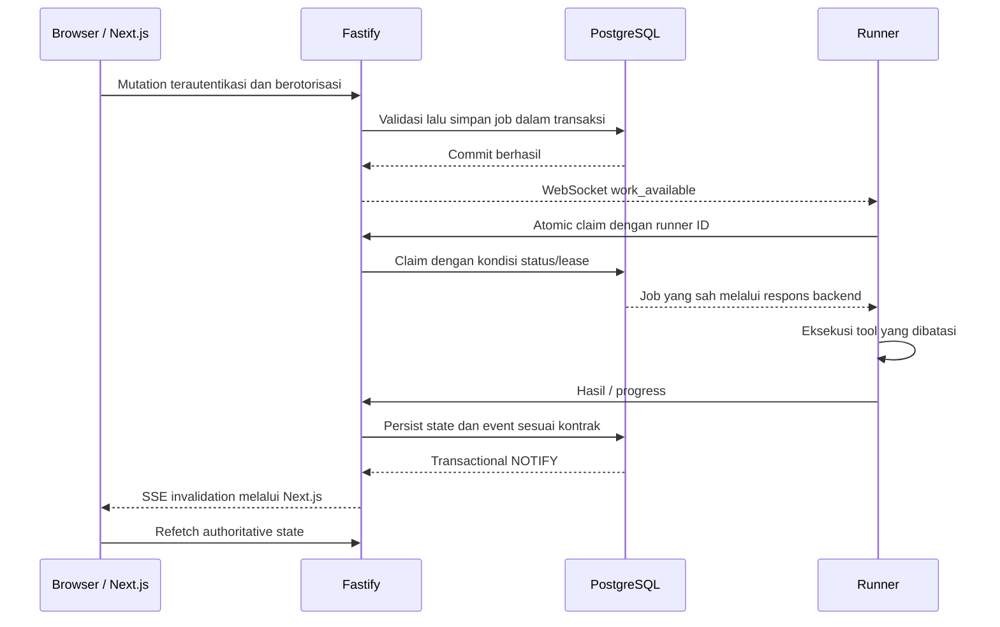

# JHC NetOps Local Backend

Backend Fastify adalah pintu masuk penyimpanan dan control plane NetOps. Next.js
dan Local Runner menggunakan bearer yang berbeda; hanya backend yang mengakses
PostgreSQL. Runtime menerima `PERSISTENCE_AUTHORITY=local_postgres` dan bind
loopback. Dokumen ini merujuk source saat ini, bukan bukti acceptance production.

## Tanggung jawab dan susunan source

| Folder/file | Tanggung jawab |
| --- | --- |
| `src/config.ts` | Validasi environment, token, DSN dedicated, dan konfigurasi modul |
| `src/main.ts` | Merangkai repository, pool, listener, scheduler, dan shutdown |
| `src/server.ts` | Registrasi route, batas request, safe logging, dan lifecycle Fastify |
| `src/persistence/` | Repository domain dan route aplikasi berbasis PostgreSQL |
| `src/local-auth/` | Registrasi, login, opaque session, dan scrypt password record |
| `src/realtime/` | Validasi invalidation, broker SSE, dan dedicated LISTEN connection |
| `src/runner-control/` | WebSocket runner serta state presence/monitoring P18 |
| `src/runner-work/` | Durable availability, HTTP long-poll compatibility, dan expiry recovery |
| `src/network-health/`, `src/traffic/`, `src/managed-telemetry/` | Kontrak runner dan publication subsystem |
| `src/network-discovery/`, `src/device-inspector/` | Lifecycle runner untuk pekerjaan on-demand |
| `src/assets/` | Ingestion evidence, identity, history, scan, Scan Networks, dan Excel |
| `src/medical-equipment/` | Registri operasional, kalibrasi, dan servis |
| `src/report-branding/` | Branding file, validasi, dan audit mutation |
| `src/cutover/`, `src/data-migration/` | Tooling P12/P13 historis; bukan jalur persistence alternatif |

## Alur request dan data



Sinyal WebSocket/NOTIFY bisa terputus; job tetap berada di PostgreSQL. Backend
mengecek antrean durable dan menjalankan expiry recovery secara terpisah.
Duplicate hint tidak memberi hak eksekusi kedua: atomic claim/status binding
tetap menentukan siapa yang dapat memproses job.

## API berdasarkan trust boundary

Tabel ini adalah peta route, bukan daftar payload lengkap. Gunakan
`contract.ts`, `route.ts`, dan test subsystem saat mengubah integrasi.

| Route | Pemakai / fungsi |
| --- | --- |
| `GET /healthz` | Liveness proses; bukan bukti DB, schema, atau seluruh perangkat sehat |
| `/api/auth/*` | Next server dengan frontend bearer; register/login/session/logout |
| `/api/application/*` | Next server dengan frontend bearer; read/mutation domain dan pemeriksaan actor |
| `GET /api/application/presence` | Frontend bearer + session opaque valid/approved; lease tab terlihat |
| `GET /api/realtime/events` | SSE backend yang diproxy Next; invalidation saja |
| `GET /api/runner/control` | Upgrade WebSocket loopback dengan runner bearer, tanpa browser Origin |
| `POST /api/runner/heartbeat` | Heartbeat HTTP compatibility |
| `POST /api/runner/work/wait` | Long-poll compatibility; tidak meng-claim job |
| `POST /api/runner/network-health` | Assignment/publication Health serta service action terkait |
| `POST /api/runner/traffic` | Session dan snapshot/flow runner |
| `POST /api/runner/managed-telemetry` | Target dan publication telemetry/observed hosts |
| `POST /api/runner/network-discovery` | Claim prepare/scan, context, progress, complete/fail |
| `POST /api/runner/device-inspector` | Claim dan hasil/failure inspection |

Bearer memberi akses ke boundary tertentu; actor role/status, runner/session ID,
target, expected state, lease, allowlist field, dan ukuran payload tetap diperiksa
sesuai route. Jangan menganggap body dari frontend atau runner otomatis dipercaya.

## Environment dan database

Salin [example](.env.example) menjadi `.env` lokal jika belum ada, lalu isi nilai
melalui prosedur pengelolaan secret. Jangan mencetak atau meng-commit nilai nyata.

| Variable | Fungsi / aturan |
| --- | --- |
| `HOST`, `PORT` | Default `127.0.0.1:3402`; HOST hanya loopback |
| `PERSISTENCE_AUTHORITY` | Wajib `local_postgres`; tidak ada authority remote |
| `APPLICATION_DATABASE_URL` | Pool aplikasi, Local Auth, queue, dan realtime |
| `DATABASE_URL` | Pool Asset/Medical; target dedicated DB yang sama |
| `RUNNER_API_TOKEN` | Cocok dengan `LOCAL_BACKEND_TOKEN` runner/agent |
| `FRONTEND_API_TOKEN` | Cocok dengan `LOCAL_BACKEND_FRONTEND_TOKEN` Next server |
| `MONITORING_STANDBY_GRACE_MS` | Default 30000; rentang valid 0–300000 |
| `REPORT_BRANDING_DIR` | Folder branding persisten; default development `data/report-branding` |
| `MEDICAL_DUE_SOON_DAYS` | Default 30; rentang valid 1–180 |
| `ASSET_SCAN_NETWORKS` | Bootstrap satu kali untuk daftar jaringan; konfigurasi tersimpan di DB selanjutnya menjadi authority |
| `ASSET_SCAN_HELPER_PATH` | Helper privileged yang direview; bukan arbitrary shell command |
| `ASSET_SCAN_CONCURRENCY` | Batas paralel fingerprint; default 4, divalidasi kontrak |
| `ASSET_SCAN_HOST_TIMEOUT_MS`, `ASSET_SCAN_DISCOVERY_TIMEOUT_MS` | Deadline scan yang dibatasi server |
| `P13_CANDIDATE_READ_ONLY` | Switch historis; `true` ditolak pada runtime local-only saat ini |

DSN runtime wajib `postgresql:`, host loopback, port `5433`, database
`jhc_netops`, username `jhc_netops_app`, dan password terisi; query/hash URL
ditolak. Nama dua variable DSN bukan alasan membuat dua authority database.
Dengan konfigurasi penuh, kedua modul harus mengarah ke dedicated DB yang sama.

Pool aplikasi dan Asset terpisah; LISTEN menggunakan session PostgreSQL
tersendiri. Pool mempunyai batas koneksi dan deadline. Kehilangan LISTEN
ditangani dengan reconnect/re-LISTEN serta sync invalidation agar browser
membaca ulang state. NOTIFY bukan log replay durable.

**Startup bukan operasi read-only.** Selain membuka listener, backend dapat
menginisialisasi Scan Networks, menandai scan terputus, dan menjalankan expiry
job. Jangan menyalakan candidate paralel terhadap DB live untuk sekadar mencoba
build. Startup tidak menjalankan DDL migration.

## P18, monitoring, dan kompatibilitas HTTP

Presence valid mengaktifkan policy monitoring. `ACTIVE` mensyaratkan runner
mengakui policy revision yang berlaku. Tanpa presence/grace, pekerjaan yang sudah
diterima dan buffer hasil diselesaikan dahulu; `STANDBY` hanya dilaporkan ketika
evidence mendukungnya. Kegagalan evidence/control menghasilkan `DEGRADED`.

WebSocket membawa health report, work-kind hint, dan policy. Initial `health`
harus tervalidasi/disimpan **sebelum** server mengirim `ready`. Satu ID runner
tidak boleh mempunyai dua control socket. Liveness socket saja tidak boleh
menggantikan heartbeat aplikasi. Detail limit, reconnect, dan timer ada di
[P18](../docs/P18_ZERO_IDLE.md).

Jalur compatibility P17 tetap lokal:

- Body work-wait hanya berisi runner ID, atau opt-in `wait_seconds: 60`.
- Body lama memakai wait 10 detik; quiet wait memakai 60 detik. Deadline runner
  masing-masing 20/70 detik; durable check tetap maksimal sekitar 10 detik sekali.
- Satu waiter per runner, maksimum 32; tidak menahan transaksi selama menunggu.
- Expiry maintenance startup dan setiap 10 detik setelah pass sebelumnya selesai,
  maksimal 100 row per subsystem/pass dengan `SKIP LOCKED`.
- Hanya 404/405 mengizinkan fallback endpoint lama; auth/error DB tidak boleh
  diubah menjadi downgrade otorisasi.

Semua ini mengurangi HTTP idle, bukan menghapus pekerjaan DB. Prioritas work
adalah Manual Ping → Traffic → Discovery → Device Inspector.

## Domain penyimpanan

| Data | Area utama |
| --- | --- |
| Akun, credential, session | `public.profiles`, `local_auth_credentials`, `local_auth_sessions` |
| Runner dan inventory kontrol | `diagnostic_runners`, `network_nodes`, `network_targets` |
| Health | `network_health_latest`, `network_health_samples`, `network_health_ping_jobs`, events |
| Traffic | `traffic_live_sessions`, `traffic_live_snapshots` (termasuk flow snapshot), `flows`, `traffic_metrics` |
| Discovery / Inspector / Diagnostics | Session/job domain serta bandwidth/hop measurements |
| SNMP | `managed_telemetry_targets`, latest system/interface, observed hosts, telemetry events |
| Asset dan alat medis | Schema `asset`; identity, endpoint history, changes, scan, registry/history |
| Audit | Lifecycle account dan administrative audit yang append-only |
| Branding | Filesystem persisten, dengan safe audit summary di database |

Tabel outbox/watermark lama dan tool cutover tetap evidence historis; runtime
tidak menjalankan Supabase shadow projector.

## Development dan verifikasi

Dari folder `backend`, setelah environment dan database siap:

```powershell
npm.cmd ci
npm.cmd run dev
```

Build/start production lokal menggunakan `npm.cmd run build` lalu
`npm.cmd start`; script start tidak otomatis memuat `.env`. Environment harus
sudah diekspor oleh shell/launcher. Launcher production repository menangani itu.

```powershell
npm.cmd test
npm.cmd run typecheck
npm.cmd run lint
npm.cmd run build
```

Uji database adalah gate berbeda:

| Perintah dari `backend` | Kebutuhan / dampak |
| --- | --- |
| `npm.cmd run preflight:postgres` | Koneksi read-only opt-in ke DB terkonfigurasi; verifikasi identitas dan baseline, bukan seluruh acceptance P18 |
| `npm.cmd run test:postgres:assets` | Integration Asset; review guard dan fixture sebelum menjalankan |
| `npm.cmd run test:postgres:integration` | Integration dengan database dan row fixture; bukan read-only |

Gunakan cluster PostgreSQL 16 **terisolasi** untuk integration. Workflow
[PG16 CI](../.github/workflows/p18-postgres-integration.yml) menyiapkan cluster
ephemeral dengan guard production; privilege/credential fixture CI bukan template
provisioning production. Jangan memakai service PostgreSQL proyek lain atau
database production. Uji unit dengan fake repository tidak membuktikan perilaku
FK/CHECK/transaction di PostgreSQL nyata.

## Troubleshooting dan deployment

| Gejala | Arah pemeriksaan |
| --- | --- |
| Config ditolak | Exact authority, DSN, loopback, token minimum 32 karakter, dan placeholder yang belum diganti |
| `401` | Jenis bearer sesuai boundary; jangan mencetak header untuk diagnosis |
| `403` / conflict lifecycle | Role/status actor, binding target/runner/session, expected state dan lease |
| WS tertutup sekitar initial handshake | Pastikan client mengirim health valid sebelum menunggu ready; periksa close code yang aman |
| Job tidak diklaim | Row queued dan lease, runner registration/capability, work hint, lalu atomic claim |
| UI SSE tersambung tetapi data lama | NOTIFY topic/key, listener recovery, authoritative refetch, serta waktu observasi |
| Inventory berubah setelah read | Sinkronisasi evidence bounded pada jalur read/report dapat menulis evidence; jangan menganggap semua GET bebas efek persistence |

Untuk deployment, baca [runbook PostgreSQL](../deploy/postgresql/README.md) dan
[P18 rollout](../docs/P18_ZERO_IDLE.md). Install dependensi pada ketiga komponen
Node. Urutan P18 adalah backend → frontend presence → runner; backend tetap satu
instance/fork. Rollback runner lebih dahulu sesuai runbook. Symlink rollback
tidak membatalkan schema atau data, dan restart hanya boleh menarget proses
NetOps yang direview.
