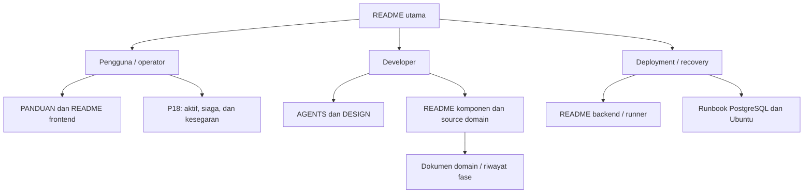

# Pusat Dokumentasi JHC NetOps

Dokumentasi dibagi menurut kebutuhan pembaca, bukan hanya urutan fase proyek.
Mulailah dari [README utama](../README.md) untuk arsitektur, fitur, istilah,
setup dasar, dan batas operasi.

## Jalur baca

| Pembaca | Urutan yang disarankan |
| --- | --- |
| Pengguna baru | README utama → [frontend](../frontend/README.md) → bagian fitur pada panduan domain |
| Operator | [PANDUAN](PANDUAN.md) → [P18](P18_ZERO_IDLE.md) → [runner](../runner/README.md) → troubleshooting komponen |
| Developer frontend | [AGENTS](AGENTS.md) → [DESIGN](DESIGN.md) → [frontend](../frontend/README.md) |
| Developer backend/collector | AGENTS → [backend](../backend/README.md) → [agent](../agent/README.md) → kontrak/test domain |
| Administrator akun | [AUTH_SETUP](AUTH_SETUP.md) → [kesiapan administratif P17](P17_ADMINISTRATIVE_READINESS.md) |
| Operator release/recovery | [HANDOVER](HANDOVER.md) → README komponen → P18 → [runbook PostgreSQL](../deploy/postgresql/README.md) |

## Runtime saat ini dan cara memakai dokumen lama

Source aktif menggunakan Local Auth, PostgreSQL dedicated, local SSE, dan control
WebSocket P18. Browser hanya memakai origin Next.js; backend dan database tetap
loopback. Tidak ada Supabase sebagai persistence/Auth/Realtime runtime.

[PRD](PRD.md), [PLANNING](PLANNING.md), [HANDOVER](HANDOVER.md), dan panduan fase
menyimpan perkembangan proyek. Sebagian bagian historis masih menjelaskan
arsitektur lama. Untuk setup runtime saat ini, dahulukan README utama/komponen,
source yang direview, dan runbook yang berlaku pada release tersebut. Aturan
keamanan [AGENTS](AGENTS.md) tetap berlaku.

Dokumen source tidak menetapkan apakah suatu SHA sudah production accepted.
Catatan test harus menyebut perintah, lingkungan, hasil, serta apa yang memakai
fixture. Jangan menyimpulkan keberhasilan PG16, SNMP nyata, browser, atau
CAP_NET_RAW dari unit test dan build saja.

## Panduan komponen dan operasi

| Dokumen | Isi / kapan dipakai |
| --- | --- |
| [Frontend](../frontend/README.md) | Route UI, authorization, data flow, i18n, presence, test dan Playwright |
| [Backend](../backend/README.md) | API boundary, repository, env, database, queue, recovery, dan troubleshooting |
| [Runner](../runner/README.md) | Config Windows/WSL/native, scheduling, claim, fallback, state, dan shutdown |
| [Agent](../agent/README.md) | Python/venv, collector, CLI, buffer, tool/capability, dan test |
| [Helper scripts](../scripts/README.md) | Allowlist LAN Diagnostics lokal dan dampak perubahan config |
| [AUTH_SETUP](AUTH_SETUP.md) | Local login/session, approval, dan enrollment operator untuk profile existing |
| [P18 Zero Idle](P18_ZERO_IDLE.md) | Presence/grace, runtime states, protocol, fallback, rollout, dan batas bukti soak |
| [AGENT_SETUP](AGENT_SETUP.md) | Panduan setup komponen; cocokkan dengan README/source terbaru sebelum menjalankan |
| [Portable Development](PORTABLE_DEVELOPMENT.md) | Fixture UI SNMP read-only; tidak menjalankan poll dan bukan backend/auth emulator |
| [Ubuntu Always-on](UBUNTU_ALWAYS_ON_DEPLOYMENT.md) | Deployment/recovery native, shared state, serta process manager; baca bersama policy P18 |
| [PostgreSQL](../deploy/postgresql/README.md) | Exact cluster isolation, provisioning/recovery, dan pemisahan runbook historis |
| [Migration index](../backend/migrations/README.md) | Tujuan migration 001–019, prerequisites, dan operator-only application |

Istilah “always-on” pada panduan host berarti proses runtime tersedia. Pada P18,
scheduled Health/SNMP tetap mengikuti policy presence; proses online tidak sama
dengan collector yang terus melakukan probe tanpa pengguna.

## Panduan fitur/domain

| Dokumen | Batas pembahasan |
| --- | --- |
| [P10D1-B Active Inventory Scan](P10D1B_ACTIVE_INVENTORY_SCAN.md) | Quick/Deep Scan dan fixed helper contract |
| [P10D2 Asset Change History](P10D2_ASSET_CHANGE_HISTORY.md) | Meaningful identity/evidence changes, bukan riwayat reachability |
| [P10D3 Scan Networks](P10D3_SCAN_NETWORK_SETTINGS.md) | Allowlist jaringan dan routed scope |
| [P10E Asset Reporting](P10E_ASSET_REPORTING.md) | Ekspor Excel dan batas/filter laporan |
| [P10F Medical Equipment](P10F_MEDICAL_EQUIPMENT.md) | Registri alat medis, link aset, kalibrasi, dan servis |
| [P17 Administrative Readiness](P17_ADMINISTRATIVE_READINESS.md) | Lifecycle akun, audit, dan perbaikan UX administratif |
| [DESIGN](DESIGN.md) | Design tokens, tipografi, layout responsif, dan pola interaksi |

## Riwayat arsitektur dan bukti immutable

| Dokumen/folder | Status penggunaan |
| --- | --- |
| [P11 Foundation](P11_LOCAL_POSTGRESQL_FOUNDATION.md) | Riwayat foundation dan preflight DB |
| [P12 Rehearsal](P12_SCHEMA_DATA_MIGRATION_DRY_RUN.md) | Rehearsal/repeatability historis, bukan prosedur install rutin |
| [P13 Cutover](P13_APPLICATION_DB_CUTOVER.md) | Bukti dan runbook migrasi authority terdahulu |
| [P12 runbook](../deploy/postgresql/p12/README.md), [P13 runbook](../deploy/postgresql/p13/README.md) | Tooling administratif historis; jangan dipakai tanpa scope/run contract |
| [Supabase archive](../supabase/README.md) | Migration lama/evidence; bukan layanan runtime yang perlu diaktifkan |
| [P10D split plan](P10D_SPLIT_PLAN.md), [reference audit](reference/feature-audit.md) | Keputusan/rencana terdahulu, bukan kontrak API aktif |
| [Ubuntu readiness lama](UBUNTU_DEPLOYMENT_READINESS.md) | Audit fase P8A; bukan bukti acceptance release sekarang |

Screenshot, manual book, dan bahan presentasi membantu penjelasan produk tetapi
tidak mengalahkan source atau aturan authorization. Artefak lokal/untracked belum
otomatis menjadi dokumentasi release yang diterbitkan.

## Merawat dokumentasi

1. Perbarui README komponen saat command, environment, route, atau lifecycle berubah.
2. Jelaskan working directory, prasyarat, efek samping, dan lingkungan tujuan tiap
   command; pisahkan development, integration fixture, dan production.
3. Gunakan contoh sintetis dan nama variable. Jangan salin config/log/secret nyata.
4. Gunakan diagram Mermaid untuk relasi/alur; tabel untuk kontrak/mapping.
   Renderer yang tidak mendukung Mermaid tetap dapat memakai penjelasan teks.
5. Pertahankan migration dan bukti historis; koreksi penjelasan aktif tanpa
   menulis ulang hasil acceptance yang pernah terjadi.
6. Periksa relative link dan `git diff --check`. Update docs saja tidak memerlukan
   menjalankan probe, migration, atau seluruh quality gate aplikasi.
