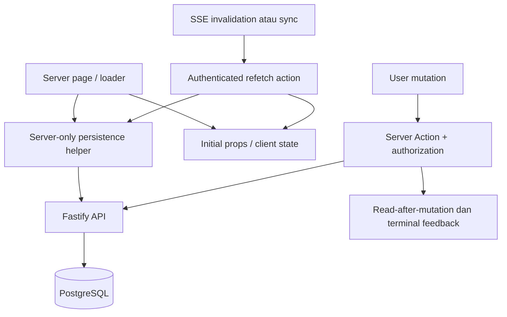

# JHC NetOps Frontend

Frontend adalah workspace Next.js App Router untuk pengguna NetOps. Halaman dan
Server Actions membaca state melalui backend lokal; browser berkomunikasi dengan
origin aplikasi yang sama. Login memakai Local Auth. Tidak ada koneksi
PostgreSQL atau bearer backend dalam browser.

## Peta halaman

| Route | Isi dan alur utama |
| --- | --- |
| `/login`, `/register`, `/auth/resolve`, `/pending` | Login/registrasi, evaluasi session/profile, dan status approval |
| `/dashboard` | Ringkasan, Health Watch, Reachability Map, tren historis, Manual Ping, dan Discovery |
| `/traffic` | Traffic Live per runner, session capture, snapshot, dan flow |
| `/history`, `/alerts` | Riwayat/event dan alert yang tersimpan |
| `/devices` | Inventaris node, identity yang disimpan operator, Health configuration, dan Device Profile |
| `/snmp` | Workspace satu selected managed target: ringkasan sistem, interface, dan CTA observed hosts |
| `/snmp/[targetId]/hosts` | Daftar Observed LAN Hosts untuk target tersebut, search/filter/sort |
| `/diagnostics` | Preflight dan LAN Diagnostics yang diotorisasi |
| `/assets` | Asset Inventory, evidence/endpoint/change detail, Scan Networks, scan, dan ekspor Excel |
| `/medical-equipment`, `/medical-equipment/[id]` | Registri alat medis serta riwayat kalibrasi/servis |
| `/profile` | Profil sendiri dan perubahan nama yang diizinkan |
| `/admin` | Pengelolaan akun, lifecycle, branding, dan audit sesuai hak Admin |

Device Profile menggunakan drawer/provider existing; ia bukan halaman baru untuk
setiap entry point. Observed LAN Hosts adalah kemampuan kontekstual target SNMP,
bukan item sidebar terpisah. Satu target selection mengontrol workspace SNMP;
detail interface dibuka sesuai kebutuhan.

## Susunan source

| Lokasi | Fungsi |
| --- | --- |
| `app/(protected)/` | Page server, loading skeleton, dan approved-profile layout |
| `app/actions/` | Read/mutation server, validasi form, otorisasi, serta feedback hasil |
| `app/api/realtime/` | Proxy SSE same-origin untuk event dan presence |
| `components/` | Komponen UI per domain dan primitive design system |
| `lib/application-persistence.ts` | Helper server-only menuju API aplikasi |
| `lib/local-auth.ts`, `lib/auth.ts` | Session lokal, profile normalization, dan guard |
| `lib/network-health-realtime.ts` | Shared event invalidation dan lifecycle koneksi lintas topic |
| `lib/local-realtime-route.ts` | Proxy SSE server-side, auth, dan cancellation |
| `lib/traffic-refresh.ts` | Refresh coordinator, visibility, coalescing, dan fallback Traffic |
| `i18n/id/`, `i18n/en/` | Katalog Indonesia/Inggris |
| `tests/*.test.ts` | Unit/behavior/source-contract test sesuai konvensi project |
| `tests/browser/` | Browser acceptance Playwright dengan prasyarat lingkungan terpisah |

## Data flow dan realtime



Initial SSR state mencegah tampilan kosong yang tidak perlu. Event realtime
memberi topic/key, bukan row yang boleh langsung menggantikan state. Browser
melakukan authoritative refetch dengan coalescing/single-flight sesuai fitur.
Reconnect/sync juga meminta reconciliation; fallback polling tetap dibatasi
untuk kondisi yang memerlukannya.

Ada dua stream berbeda:

| Same-origin endpoint | Fungsi |
| --- | --- |
| `/api/realtime/events` | Invalidation topik `network_health`, `diagnostics`, `device_inspector`, `traffic`, `managed_telemetry`, serta `sync` |
| `/api/realtime/presence` | Menyatakan presence tab terlindungi yang visible dan menerima state monitoring P18 |

Protected layout mempunyai satu owner presence, bukan satu per widget. Tab
hidden melepas presence dan menghentikan stream/refresh yang mengikuti visibility.
Tab visible kembali melakukan reconnect/refetch. Presence session approved
diperiksa server; jangan mengganti ini dengan user ID dari browser.

**Meminimalkan/background tab terakhir bisa menjeda Health/SNMP setelah grace.**
Global banner serta Health/SNMP detail membedakan data live dari observasi lama.
Jangan menghapus timestamp, memalsukan sampel kosong menjadi nol, atau menyebut
monitoring aktif hanya karena SSE tersambung. Detail policy ada di
[P18](../docs/P18_ZERO_IDLE.md).

Traffic memakai event-driven refresh, bukan polling 5/10 detik tanpa syarat.
Fallback disconnected dibatasi sesuai active/idle state, dengan reconciliation
watchdog; mutation confirmation harus memakai read yang dimulai setelah mutation
selesai. Jangan menambahkan `router.refresh()` pada setiap render/event.

## Otorisasi dan UX

Approved profile adalah syarat masuk workspace, terpisah dari role.

- Viewer membaca data; Operator/Admin dapat menjalankan operasi yang memang
  diizinkan action terkait.
- Manual Ping memerlukan Admin. Tombolnya tidak boleh memakai flag operasional
  umum yang juga bernilai true untuk Operator.
- Admin-only action tetap memakai guard server dan pemeriksaan repository.
- Disabled berbeda dari rejected/suspended; session disabled gagal tertutup.
- Role selector dan access status bukan satu field; jangan mengubah mapping
  status atau self/last-login-capable-admin protection lewat UI.
- ActionFeedback berasal dari tindakan pengguna: success auto-dismiss, error
  penting persistent, dan satu feedback terminal per mutation/attempt.
  Background refetch tidak boleh menghasilkan toast sukses otomatis.

Semua teks baru memakai katalog EN/ID yang sesuai. Missing-value placeholder
menggunakan `-`; null measurement tidak boleh dibaca sebagai angka nol.
Gunakan token [design system](../docs/DESIGN.md), focus-visible, accessible name,
dan perilaku mobile yang sama dengan komponen existing.

Health history mempunyai batas 20 target UUID per request. Dengan >20 target,
SSR/client menggunakan default satu target yang sama secara deterministik; semua
target individual masih tersedia. Jangan memberi label “Semua” untuk subset
atau membuat request berulang hanya karena object SSR berubah referensi.

## Environment dan development

Dari folder `frontend`, salin [.env.example](.env.example) jika `.env.local`
belum ada, kemudian konfigurasikan:

| Variable | Makna |
| --- | --- |
| `PERSISTENCE_AUTHORITY` | Wajib `local_postgres` |
| `LOCAL_BACKEND_URL` | Loopback backend; digunakan server saja |
| `LOCAL_BACKEND_FRONTEND_TOKEN` | Harus cocok dengan `FRONTEND_API_TOKEN` backend |
| `NEXT_PUBLIC_SITE_URL` | URL situs sesuai kebutuhan deployment; bukan tempat token |

```powershell
npm.cmd ci
npm.cmd run dev
```

Dev server default di `http://localhost:3000`. Untuk runtime penuh, backend,
dedicated DB/schema, dan profile/credential lokal harus siap. Frontend tidak
membuat akun Admin otomatis dan tidak memprovision database.

[Portable Development](../docs/PORTABLE_DEVELOPMENT.md) hanya menyediakan fixture
UI Managed SNMP pada development. Ia bukan bypass login, backend palsu untuk
seluruh aplikasi, atau bukti acceptance collector.

## Pengujian

Dari folder `frontend`:

```powershell
npm.cmd test
npm.cmd run typecheck
npm.cmd run lint
npm.cmd run build
```

`build` menggunakan webpack sesuai script repository; `build:turbopack` tersedia
sebagai jalur terpisah. Jangan menganggap hasil keduanya identik tanpa pengujian.
Font berasal dari `next/font/google`; akses resource font pada build/dev dapat
menjadi kendala lingkungan. Jangan melemahkan auth untuk membuat build/browser
test berjalan.

### Browser acceptance

Playwright memulai Next.js nyata dan tidak memock API dalam suite presence.
Konfigurasi menolak reuse server yang kebetulan ada pada port test. Ia tetap
memerlukan backend/DB fixture yang sudah disiapkan operator, approved test
credential, dan runner fixture untuk menguji ACTIVE.

Sebelum opt-in, pastikan `127.0.0.1:3402` bukan backend production. Setel secara
aman di shell: `P18_BROWSER_TEST_ISOLATED=1`, `LOCAL_BACKEND_URL` tepat
`http://127.0.0.1:3402`, `LOCAL_BACKEND_FRONTEND_TOKEN`,
`P18_BROWSER_TEST_EMAIL`, dan `P18_BROWSER_TEST_PASSWORD`. Jangan menaruh
credential nyata dalam source, screenshot, trace, atau command history.

```powershell
npx.cmd playwright install chromium webkit
npm.cmd run test:browser -- --project=chromium --workers=1
npm.cmd run test:browser -- --project=mobile-chrome --workers=1
npm.cmd run test:browser -- --project=mobile-safari --workers=1
npx.cmd playwright show-report
```

Suite saat ini mempunyai 11 skenario per project; enam ditandai skip dengan
alasan karena belum mempunyai mekanisme observasi standby/visibility atau
fixture yang memadai. Tanpa environment opt-in, suite di-skip. Skipped bukan
PASS; beberapa tab satu browser context juga bukan pengujian multi-user.
Mendispatch event `visibilitychange` saja tidak menyembunyikan tab.
Desktop/mobile emulation tidak menggantikan acceptance perangkat fisik.

## Troubleshooting

| Gejala | Periksa |
| --- | --- |
| Halaman error sebelum login | `PERSISTENCE_AUTHORITY` dan environment Next server |
| Login kembali ke login | Backend/credential/session, approved status, dan origin/cookie sesuai setup |
| Form ditolak | Exact field allowlist dan role guard; jangan mengirim field internal tambahan |
| Pending/queued tampak lama | Authoritative session/job, runner freshness/capability, lalu mekanisme refresh domain |
| Banner berubah tinggi atau layout bergeser | Loading skeleton dan ruang banner; jangan mengubah tinggi dari string state sementara |
| Banyak POST halaman berulang | Pemanggil Server Action, interval/effect, SSE burst, serta visibility; satu aksi user bukan alasan refresh storm |

Panduan auth ada di [AUTH_SETUP](../docs/AUTH_SETUP.md). Deployment memakai
launcher dan environment shared yang direview; `npm run dev` bukan server
production. Jangan mengekspos bearer backend atau loopback URL melalui client
props, `NEXT_PUBLIC_*`, JSON response, atau bundle.
