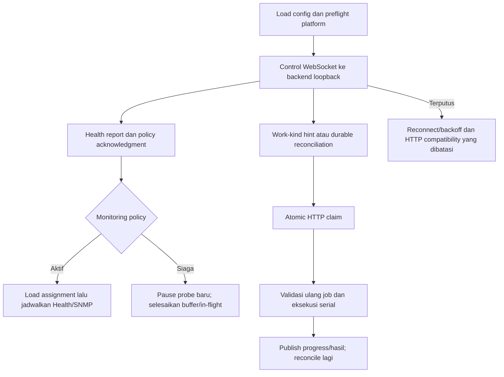

# JHC NetOps Local Runner

Runner adalah proses Node.js yang menjembatani job tersimpan di backend dengan
tool pada mesin lokal. Ia memeriksa identitas runner, scope target, capability,
dan lease sebelum mengeksekusi agent. Runner tidak membuka HTTP endpoint publik
dan tidak menerima arbitrary command dari browser.

Runtime didukung pada **native Ubuntu** dan **Windows dengan agent di WSL**.
Gunakan [agent README](../agent/README.md) untuk instalasi Python/tool; production
normal tidak perlu menjalankan Python collector sebagai aplikasi PM2 tersendiri.

## Cara kerja P18



Job tidak disimpan dalam socket. PostgreSQL tetap menjadi antrean durable;
socket hanya mengirim hint dan policy. Priority dispatch adalah:

1. Manual Ping.
2. Traffic Live.
3. Network Discovery.
4. Device Inspector.

Pelaksanaan pekerjaan tersebut tetap serial. Capture Traffic yang aktif dapat
menahan dispatch berikutnya; snapshot dan stop handling capture tetap berjalan.
Job/capability/busy gate harus diperiksa sebelum pengguna diberi janji eksekusi.
Menambah frekuensi loop tidak membuat pekerjaan agent yang panjang menjadi paralel.

Heartbeat, watch Health, dan watch SNMP mempunyai lifecycle sendiri. Preset
interval target bukan interval claim atau heartbeat. Scheduled monitoring dipause
ketika policy meminta standby; pekerjaan yang sudah diterima dan dirty buffer
tidak dibuang. Aktivasi me-reload assignments sebelum membuat observasi baru.

## Config dan environment

Mulai dari [config.example.json](config.example.json) untuk development atau
[deployment example](../deploy/runner-config.example.json) untuk memahami
struktur native Ubuntu. Keduanya template; path/interface/profile contoh belum
berarti perangkat atau autentikasi siap dipakai.

Dari root repository:

```powershell
if (!(Test-Path runner/config.local.json)) {
  Copy-Item runner/config.example.json runner/config.local.json
}
if (!(Test-Path runner/.env)) {
  Copy-Item runner/.env.example runner/.env
}
npm.cmd --prefix runner ci
```

| Field config | Makna |
| --- | --- |
| `runner_id` | ID stabil yang dipakai assignment dan session; jangan memakai ID sama untuk dua runner aktif |
| `display_name` | Nama yang terlihat di UI |
| `native_project_root` | Root project pada Linux native |
| `wsl_distro`, `wsl_project_root` | Distro dan path project dari sudut pandang WSL pada Windows |
| `agent_executable` | Path relatif executable agent dari root project platform |
| `environment_file` | File env; path relatif dihitung dari direktori file config |
| `data_directory`, `log_directory` | State dan log; path relatif juga dihitung dari direktori config |
| `source_locations` | Label lokasi yang diiklankan secara aman |
| `targets` | Allowlist **LAN Diagnostics**, bukan assignment Health atau SNMP |
| `durations` | Durasi diagnostik yang diizinkan |
| `traffic_interface`, `traffic_durations_seconds` | Interface capture dan durasi yang dibatasi |
| `enable_manual_ping` | Capability Manual Ping; action pengguna tetap Admin-only |
| `enable_diagnostic_demo` | Demo localhost eksplisit; bukan izin scan LAN |
| `poll_interval_ms`, `heartbeat_interval_ms` | Konfigurasi 1000–60000 ms; contoh deployment 60000 |
| `enable_snmp_telemetry` | Mengaktifkan watch SNMP lokal, bukan otomatis mengaktifkan target |
| `snmp_max_concurrent` | Batas collector SNMP bersamaan |
| `snmp_timeout_seconds` | Timeout SNMP dalam detik, bukan millisecond |
| `snmp_poll_intervals_seconds` | Nilai interval target yang runner dukung |
| `snmp_credential_profiles` | Credential lokal berdasarkan profile ref |

Environment [.env.example](.env.example):

- `PERSISTENCE_AUTHORITY=local_postgres`.
- `LOCAL_BACKEND_URL` menuju Fastify loopback.
- `LOCAL_BACKEND_TOKEN` cocok dengan `RUNNER_API_TOKEN` backend.
- `ENABLE_DIAGNOSTIC_DEMO` adalah override demo eksplisit bila digunakan.

Config memuat env yang dirujuk `environment_file`; variable yang sudah ada di
process environment tidak ditimpa. Deployment launcher juga memuat shared env.
Jangan mencetak seluruh config/env untuk diagnosis karena credential ada di dalamnya.

Credential SNMP hanya di-resolve di runner dan diberikan ke agent melalui jalur
yang direview. Backend hanya mengetahui `credential_profile_ref`, bukan password
auth/priv atau community. Placeholder yang valid secara sintaks bukan bukti
credential resmi/operasional. `SNMP_PROFILE_*` environment tidak didukung.

## Menjalankan runner

Default config adalah `runner/config.local.json`, independen dari working
directory. Dari root repository:

```powershell
npm.cmd --prefix runner start
```

Memakai path config lain:

```powershell
node runner/src/main.mjs --config '<PATH_CONFIG_LOKAL>'
```

Windows memerlukan WSL dan venv **Linux** di path yang sesuai. Jangan menunjuk
executable Windows ke runner yang mengharapkan binary Linux. Native Ubuntu
memerlukan `native_project_root` yang valid dan interface capture yang benar.

| Perintah | Efek |
| --- | --- |
| `npm.cmd --prefix runner run preflight` | Memeriksa tool/platform dan mencoba heartbeat; bukan pemeriksaan offline/read-only |
| `npm.cmd --prefix runner run once` | Menjalankan satu rangkaian dispatch; **dapat mengklaim dan mengeksekusi job**, bukan dry run |
| `npm.cmd --prefix runner test` | Test runner; tidak sama dengan acceptance perangkat nyata |

Preflight yang gagal membuat runner degraded dan menghentikan runtime normal
sesuai kontrak. Tool opsional dapat memengaruhi capability fitur tanpa berarti
setiap pemeriksaan dasar tersedia. Jangan mengiklankan capability hanya karena
nama binary atau profile ref tercantum pada config.

## Interval, liveness, dan fallback

| Mekanisme | Perilaku source |
| --- | --- |
| Health/SNMP target interval | Preset Aggressive 15/30/60 detik, Moderate 900, Resource Saver 1800; Health custom lama dalam rentang valid tetap dibaca |
| HTTP heartbeat compatibility | Mengikuti config, contoh 60 detik; freshness tolerance aplikasi 120 detik |
| Control sehat P18 | Satu socket; health report berkala, policy revision, ping/pong, dan durable reconciliation backend |
| HTTP work-wait compatibility | Quiet wait 60 detik/deadline 70; body lama wait 10/deadline 20 |
| Wait timeout tanpa work | Tidak menjalankan empat empty claim |
| Socket endpoint 404/405 | Dapat menegosiasikan backend lama dan policy legacy yang didokumentasikan |
| Auth/network/DB/socket failure lain | Backoff dan DEGRADED; jangan mengaktifkan scheduled monitoring tanpa policy sah |
| Reconnect/backoff | Jitter, mulai sekitar 0,8–1,2 detik dan dibatasi sekitar 30 detik |

Dalam fallback HTTP, fresh assignment hint false dapat menekan assignment GET
pada watch yang benar-benar kosong. Cache/pending buffer, hint stale/missing,
atau assignment baru tetap harus diperiksa kembali. Pada resume P18, assignments
dibaca ulang; runner tidak boleh selamanya tidak mengetahui target baru.

P18 standby sehat/buffer bersih menargetkan nol HTTP periodik. HTTP saat startup,
claim, result, active monitoring, atau recovery adalah aktivitas yang sah.
Database dan frame socket tetap aktif. Lihat [spesifikasi P18](../docs/P18_ZERO_IDLE.md)
untuk timer/limit dan bukti pengukuran beserta batasnya.

## State, recovery, dan shutdown

`data_directory` berisi state Health/SNMP yang memungkinkan retry dan baseline
tetap konsisten. Buffer agent berada di lokasinya sendiri. Jangan menghapus
state sebagai cara rutin menyelesaikan publish failure; periksa kode error dan
kompatibilitas payload terlebih dahulu.

SIGINT/SIGTERM membatalkan wait/backoff dan membersihkan socket/timer. Pekerjaan
yang sudah diterima mengikuti jalur penyelesaian bounded existing; shutdown
bukan izin menjalankan ulang job atau menghapus lease. Backend tetap memiliki
expiry/recovery berdasarkan row persisted.

Setelah pause, baseline kontinuitas Health/counter SNMP diinisialisasi dengan
benar; jangan membuat rate/alert seolah-olah seluruh periode standby terobservasi.
Nilai terakhir tetap dapat dibaca dengan timestamp yang jujur.

## Troubleshooting dan operasi

| Gejala | Pemeriksaan |
| --- | --- |
| `Runner configuration is invalid` | Path config, JSON, field wajib, authority/token/URL; jangan dump file |
| WSL/venv tidak ditemukan | Distro, root WSL, Linux venv, executable; lihat preflight log terbatas |
| `DUPLICATE_RUNNER` | Dua proses memakai runner ID sama; identifikasi proses sebelum menghentikannya |
| `INVALID_RUNNER` / control unavailable | Schema capability/health, handshake, backend persistence dan safe close code |
| Job queued | ID assignment, online/capability, TTL, busy gate, serta atomic claim |
| SNMP tidak berjalan | Policy monitoring, watch flag, target enabled, interval due, profile ref dan tool availability |
| Capture gagal | Interface serta reviewed Traffic helper/CAP_NET_RAW; jangan menjalankan seluruh runtime sebagai root untuk memintasnya |
| Publish retry terus | Backend status/error bounded dan cache pending; jangan mengubah data/credential tanpa diagnosis |

Production menggunakan [launcher runner](../deploy/run-runner.sh) dan shared
config/state. Install dependency runner dengan `npm ci` pada setiap candidate.
P18 rollout: backend → frontend → runner; rollback runner dahulu. Gunakan satu
process manager dan nama service NetOps yang tepat. Perubahan file config
memerlukan restart melalui prosedur yang direview; jangan menjalankan dua runner
dengan ID sama untuk mencoba config baru.
